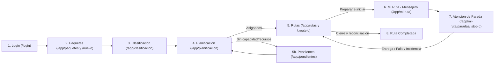
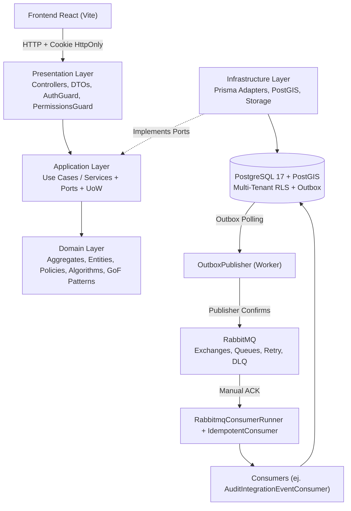
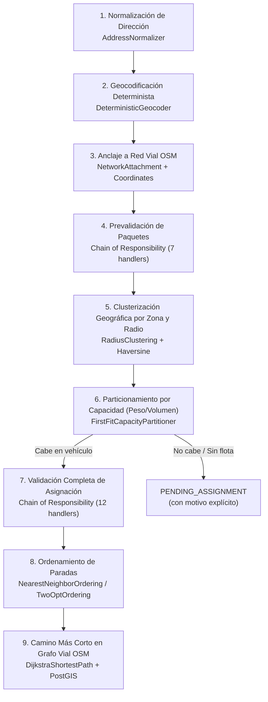

# Manual Técnico y Operativo — Smart Logistics System (SLS)

Este documento es una guía completa para operar y entender el funcionamiento interno de **Smart Logistics System (SLS)**: desde la carga de datos semilla y el acceso a las cuentas de demostración, pasando por el flujo en la interfaz de usuario (UI) y el procesamiento en el backend, hasta el detalle de los algoritmos geoespaciales/de ruteo y los patrones de diseño implementados con sus rutas exactas en el repositorio.

---

## Tabla de Contenidos

1. [Ingreso de Datos Semilla y Cuentas de Demostración](#1-ingreso-de-datos-semilla-y-cuentas-de-demostración)
2. [Flujo dentro de la UI (Frontend)](#2-flujo-dentro-de-la-ui-frontend)
3. [Flujo dentro del Backend](#3-flujo-dentro-del-backend)
4. [Proceso de los Algoritmos (Geolocalización, Clusterización, Capacidad, Ordenamiento y Red Vial)](#4-proceso-de-los-algoritmos-geolocalización-clusterización-capacidad-ordenamiento-y-red-vial)
5. [Patrones de Diseño Utilizados](#5-patrones-de-diseño-utilizados)

---

## 1. Ingreso de Datos Semilla y Cuentas de Demostración

### 1.1 Requisitos previos e infraestructura local

El proyecto se ejecuta con Docker Compose (`docker-compose.yml`), levantando:

| Servicio | Contenedor | Puerto | Propósito |
| :--- | :--- | :--- | :--- |
| PostgreSQL 17 + PostGIS 3.6 | `sls-postgres` | `5432` | Base de datos relacional y geoespacial (`sls`) |
| RabbitMQ 4 Management | `sls-rabbitmq` | `5672` / `15672` | Broker AMQP (`vhost: sls`, usuario/clave `sls`) |
| Backend HTTP API (NestJS 11) | `sls-backend` | `3000` | API REST multi-tenant (`src/main.ts`) |
| Backend Worker (NestJS 11) | `sls-worker` | — | Publicador Outbox y consumidores RabbitMQ (`src/worker.ts`) |
| Frontend (React + Vite) | `sls-frontend` | `5173` | Aplicación web operativa |

Para levantar el entorno:

```bash
docker compose up -d
```

### 1.2 Cómo cargar los datos semilla (Seeding)

Los scripts de semilla viven en `backend/prisma/` y se ejecutan desde la carpeta `backend/` (o dentro del contenedor `sls-backend`) previa compilación con `npm run build`.

```bash
cd backend

# 1. Compilar Prisma Client y TypeScript (genera dist/prisma/*.js)
npm run build

# 2. Ejecutar la semilla completa de demostración (idempotente para el tenant demo)
npm run demo:seed
```

#### Variantes de comandos de semilla disponibles (`backend/package.json`)

| Comando | Script ejecutado | Comportamiento |
| :--- | :--- | :--- |
| `npm run demo:seed` | `node dist/prisma/seed-demo` | Limpia únicamente el tenant `demo-barranquilla` y lo vuelve a poblar desde cero (usuarios, roles, permisos, catálogos, vehículo, mensajero, mapa OSM, depósito y paquetes demo). |
| `npm run demo:reset` | `node dist/prisma/seed-demo --reset-all` | Trunca todas las tablas operativas (conservando migraciones, `Permission` y `PlatformAdmin`) y re-ejecuta la semilla demo. |
| `npm run demo:seed:geography` | `node dist/prisma/seed-demo --geography-only` | Importa únicamente la geografía OSM sin tocar datos de tenants existentes. |
| `npm run demo:import:osm` | `node dist/prisma/import-osm-demo` | Importa el grafo vial y catálogo de direcciones desde `backend/prisma/data/barranquilla-demo.osm.json.gz`. |
| `npm run demo:prepare:osm` | `node dist/prisma/prepare-osm-demo` | Crea el depósito OSM demo y registra/geocodifica los paquetes de ejemplo del extracto OSM. |

#### Archivos fuente de la semilla

- Configuración e IDs deterministas: `backend/prisma/demo-config.ts`
- Orquestador principal de la semilla: `backend/prisma/seed-demo.ts`
- Importador de red vial OSM (Barranquilla): `backend/prisma/import-osm-demo.ts`
- Preparador de depósito y paquetes OSM: `backend/prisma/prepare-osm-demo.ts`
- Extractor y verificador OSM: `backend/prisma/osm-demo-extract.ts`
- Dataset comprimido de Barranquilla (El Prado–Alto Prado): `backend/prisma/data/barranquilla-demo.osm.json.gz`

### 1.3 Cuentas creadas por la semilla

> **Nota importante de acceso:** Si necesitas ingresar como **Administrador de la empresa de demostración en Barranquilla**, selecciona la pestaña **"Acceso de empresa"** en `/login` e ingresa:
> - **Slug (Identificador de empresa):** `demo-barranquilla`
> - **Correo electrónico:** `admin@demo-baq.co`
> - **Contraseña:** `DemoPassword123!`

Todas las cuentas creadas por `backend/prisma/seed-demo.ts` pertenecen al tenant **`Mensajería Barranquilla Demo S.A.S.`** (`slug: demo-barranquilla`, `id: 10000000-0000-4000-8000-000000000001`) y comparten la contraseña **`DemoPassword123!`** (hasheada con Argon2):

| Perfil / Uso | Correo electrónico | Rol | Permisos asignados | Observación |
| :--- | :--- | :--- | :--- | :--- |
| **Administrador del tenant** | `admin@demo-baq.co` | `ADMIN` | `MANAGE_TENANT`, `MANAGE_EMPLOYEES`, `REGISTER_PACKAGES`, `CLASSIFY_PACKAGES`, `COORDINATE_ROUTES`, `OPERATE_DELIVERIES` | Acceso total a la operación de la empresa demo. |
| **Empleado de recepción** | `recepcion@demo-baq.co` | `RECEPTION` | `REGISTER_PACKAGES` | Registra y consulta paquetes. |
| **Mensajero activo** | `mensajero.ruta@demo-baq.co` | `COURIER` | `OPERATE_DELIVERIES` | Registrado como entidad `Courier` activa; opera rutas asignadas en `/app/mi-ruta`. |
| **Mensajero candidato** | `mensajero.candidato@demo-baq.co` | `COURIER` | `OPERATE_DELIVERIES` | Usuario con rol `COURIER` aún sin alta como `Courier` operativo (útil para probar el alta de mensajeros en UI). |

> **Acceso de Plataforma SaaS (Superadministrador):** En `/login` existe una segunda pestaña llamada **"Plataforma SaaS"** destinada a cuentas `PlatformAdmin` (sin slug de empresa) para aprovisionar nuevos tenants en `/app/admin/empresas`.

### 1.4 Datos operativos y geográficos sembrados

Además de los usuarios y permisos, `seed-demo.ts` crea de forma determinista:

1. **Catálogos del tenant**:
   - **Zona:** `NORTH` — *Zona Norte Barranquilla* (`08d92a06-4921-4989-92ff-f1917240779c`).
   - **Sector:** `N-PRADO` — *El Prado - Alto Prado* (`2ef99933-082e-4d24-b1a1-b5c574ca6aa5`).
   - **Tipo de envío:** `STANDARD` — *Envío Urbano Estándar 24h* (`b268c5c7-b2b5-411d-b734-07746ae7e6e6`).
2. **Recursos operativos** (creados a través de los mismos servicios de aplicación de la API):
   - **Vehículo:** placa `BAQ101`, capacidad máxima **850 kg** y **6.5 m³**.
   - **Mensajero:** vinculado al usuario `mensajero.ruta@demo-baq.co`.
3. **Geografía OSM y paquetes iniciales** (vía `prepareOsmDemo`):
   - **GeoDataset OSM:** *Barranquilla · El Prado–Alto Prado · OSM demo* (nodos `RoadNode`, aristas dirigidas `RoadEdge` y referencias de direcciones `GeocodingReference`).
   - **Depósito:** *Depósito OSM demo · El Prado* (coordenadas PostGIS SRID 4326, zona horaria `America/Bogota`).
   - **Paquetes demo (`OSM-DEMO-...`)**: registrados en estado **`REGISTERED`**, geocodificados automáticamente (`MATCHED`) y anclados a la red vial (`NetworkAttachment` con perfil `MOTOR_VEHICLE` y estado `AUTO_ACCEPTED`).
   - *Nota:* La semilla **no crea rutas ni asignaciones**; el siguiente paso natural en la UI es clasificar los paquetes y ejecutar la planificación.

---

## 2. Flujo dentro de la UI (Frontend)

El enrutamiento está definido en `frontend/src/routes.tsx` y la navegación protegida por permisos en `frontend/src/app/AppShell.tsx`.

### 2.1 Zonas públicas y autenticación

1. **Inicio (`/`)** — `frontend/src/HomePage.tsx`: portada pública con acceso al portal y seguimiento.
2. **Seguimiento público (`/track` y `/seguimiento`)** — `frontend/src/track/PublicTrackingPage.tsx` y `frontend/src/seguimiento/TrackingPage.tsx`: consulta segura del estado de un paquete sin exponer datos internos del tenant.
3. **Inicio de sesión (`/login`)** — `frontend/src/login/LoginPage.tsx`:
   - Pestaña **"Acceso de empresa"**: solicita `slug`, `email` y `password` → llama a `POST /auth/login`.
   - Pestaña **"Plataforma SaaS"**: solicita `email` y `password` → llama a `POST /platform/login`.
   - El backend emite una cookie **`HttpOnly`** de sesión y el frontend consulta `GET /auth/me` (`frontend/src/auth.tsx`) para hidratar identidad, tenant, rol y lista de permisos.
   - Según el rol y los permisos, `AppShell` construye el menú lateral dinámicamente.

### 2.2 Flujo operativo paso a paso en la UI



| Paso | Ruta UI | Archivo principal | Qué ocurre en la pantalla |
| :--- | :--- | :--- | :--- |
| **1. Administración previa** | `/app/admin/usuarios`<br>`/app/admin/vehiculos`<br>`/app/admin/mensajeros`<br>`/app/admin/empresas` | `frontend/src/app/admin/usuarios/AdminUsersPage.tsx`<br>`frontend/src/app/admin/vehiculos/AdminVehiclesPage.tsx`<br>`frontend/src/app/admin/mensajeros/AdminCouriersPage.tsx`<br>`frontend/src/app/admin/empresas/AdminTenantsPage.tsx` | El administrador gestiona empleados/roles, flota de vehículos (placa, peso y volumen máximos) y mensajeros activos. El superadmin aprovisiona empresas (tenants). |
| **2. Recepción de paquetes** | `/app/paquetes`<br>`/app/paquetes/nuevo`<br>`/app/paquetes/:packageId` | `frontend/src/app/paquetes/PackagesListPage.tsx`<br>`frontend/src/app/paquetes/nuevo/NewPackagePage.tsx`<br>`frontend/src/app/paquetes/[packageId]/PackageDetailPage.tsx` | Listado filtrable de paquetes, registro manual o mediante escáner de código de barras / QR (`BarcodeScanner.tsx`, `ImageQrScanner.tsx`) con dirección, peso, dimensiones y prioridad. En el detalle se ve historial de estados y código público de rastreo. |
| **3. Clasificación** | `/app/clasificacion` | `frontend/src/app/clasificacion/ClassificationPage.tsx` | El operador revisa paquetes en estado `REGISTERED`, asigna zona/sector y confirma la clasificación, transicionando el paquete a `CLASSIFIED`. |
| **4. Planificación de rutas** | `/app/planificacion` | `frontend/src/app/planificacion/PlanningPage.tsx` | El coordinador visualiza el workspace (paquetes elegibles, vehículos y mensajeros disponibles), define parámetros (zona, radio de clusterización, selección automática o manual de recursos) y ejecuta la planificación. |
| **5. Revisión de pendientes** | `/app/pendientes` | `frontend/src/app/pendientes/PendingAssignmentsPage.tsx` | Muestra los paquetes que quedaron en `PENDING_ASSIGNMENT` junto con su motivo de dominio (sin vehículo, excede peso/volumen, sin mensajero, etc.) para resolución manual o replanificación. |
| **6. Gestión y ciclo de vida de rutas** | `/app/rutas`<br>`/app/rutas/:routeId` | `frontend/src/app/rutas/RoutesListPage.tsx`<br>`frontend/src/app/rutas/[routeId]/RouteDetailPage.tsx`<br>`frontend/src/app/rutas/RouteMap.tsx`<br>`frontend/src/app/rutas/RouteOperations.tsx` | Lista las rutas planificadas, dibuja el recorrido real sobre mapa (`RouteMap.tsx`), permite replanificar rutas editables, **preparar** la ruta (`PLANNED -> READY`), **iniciar** (`READY -> IN_PROGRESS`), interrumpir/cancelar y **cerrar** la ruta (`COMPLETED`) con resumen de reconciliación. |
| **7. Ejecución del mensajero** | `/app/mi-ruta`<br>`/app/mi-ruta/paradas/:stopId` | `frontend/src/app/mi-ruta/MyRoutePage.tsx`<br>`frontend/src/app/mi-ruta/paradas/[stopId]/StopPage.tsx` | El mensajero consulta su manifiesto y paradas ordenadas, inicia la ruta, atiende cada parada registrando **entrega exitosa** (con evidencia), **intento fallido**, **incidencia**, **reprogramación** o **devolución a depósito**. |
| **8. Notificaciones** | `/app/notificaciones` | `frontend/src/app/notificaciones/NotificationsPage.tsx` | Bandeja de avisos internos del sistema. |

---

## 3. Flujo dentro del Backend

### 3.1 Arquitectura general

El backend (`backend/src/`) es un **Monolito Modular en NestJS 11** estructurado con **Clean Architecture** dentro de cada módulo de negocio y **Arquitectura Orientada a Eventos** mediante **RabbitMQ** y un proceso **Worker** independiente:

- **Punto de entrada HTTP API:** `backend/src/main.ts` → `backend/src/app.module.ts`
- **Punto de entrada Worker asíncrono:** `backend/src/worker.ts` → `backend/src/worker.module.ts`



### 3.2 Capas internas de cada módulo

Cada capacidad de negocio en `backend/src/modules/<modulo>/` respeta la regla de dependencia `Presentation -> Application -> Domain <- Infrastructure`:

1. **`presentation/`**: Controladores NestJS, DTOs validados con `class-validator`, mapeadores de errores de dominio a códigos HTTP (`*-http-errors.ts`) y guardias de seguridad.
2. **`application/`**: Casos de uso / servicios de aplicación que orquestan el flujo de negocio, transacciones (Unit of Work) y puertos (`ports/`).
3. **`domain/`**: Lógica pura sin dependencias de NestJS ni Prisma: agregados, entidades, value objects, políticas, errores de dominio, algoritmos y patrones GoF.
4. **`infrastructure/`**: Adaptadores Prisma/SQL/PostGIS, almacenamiento local de evidencias (`local-evidence-storage.adapter.ts`) y adaptadores RabbitMQ.

### 3.3 Seguridad y aislamiento Multi-Tenant

1. **Autenticación por sesión segura (`HttpOnly` cookie)**: validada por `AuthGuard` (`backend/src/modules/auth/presentation/auth.guard.ts`) usando `ResolveSessionService`.
2. **Autorización RBAC por permisos**: validada por `PermissionsGuard` (`backend/src/modules/auth/presentation/permissions.guard.ts`) y el decorador `@RequirePermission(...)`.
3. **Aislamiento de datos en base de datos**: el `tenantId` **siempre** proviene de la sesión autenticada (nunca del cuerpo de la petición) y las operaciones transaccionales se ejecutan a través de `runWithTenant` (`backend/src/database/run-with-tenant.ts`), que configura el contexto de sesión PostgreSQL para Row-Level Security (RLS) y filtra todas las consultas por `tenantId`.

### 3.4 Mapa de módulos y endpoints principales

| Módulo | Prefijo HTTP | Controlador | Responsabilidad |
| :--- | :--- | :--- | :--- |
| `auth` | `/auth` | `backend/src/modules/auth/presentation/auth.controller.ts` | Login de tenant, logout e identidad actual (`/auth/me`). |
| `platform` | `/platform`, `/platform/tenants` | `backend/src/modules/platform/presentation/platform-auth.controller.ts`<br>`backend/src/modules/platform/presentation/platform-tenants.controller.ts` | Login de superadmin y aprovisionamiento de nuevas empresas (tenants). |
| `users` | `/users` | `backend/src/modules/users/presentation/users.controller.ts` | Alta de empleados, listado de roles, cambio de roles y estado. |
| `zones` | `/zones`, `/shipment-types` | `backend/src/modules/zones/presentation/zones.controller.ts`<br>`backend/src/modules/zones/presentation/shipment-types.controller.ts` | Catálogo de zonas, sectores y tipos de envío. |
| `vehicles` | `/vehicles` | `backend/src/modules/vehicles/presentation/vehicles.controller.ts` | Registro, listado y gestión de vehículos y capacidades. |
| `couriers` | `/couriers` | `backend/src/modules/couriers/presentation/couriers.controller.ts` | Registro, listado y gestión de mensajeros. |
| `packages` | `/packages` | `backend/src/modules/packages/presentation/packages.controller.ts` | Registro, consulta, clasificación y transiciones de estado de paquetes. |
| `geocoding` | *(uso interno)* | `backend/src/modules/geocoding/application/geocode-address.service.ts` | Normalización y geocodificación determinista de direcciones contra catálogo OSM. |
| `assignments` | *(uso interno)* | `backend/src/modules/assignments/application/assign-package-to-route.service.ts` | Validación en cadena y reserva transaccional de capacidad. |
| `route-planning` | `/routes/planning` | `backend/src/modules/route-planning/presentation/route-planning.controller.ts` | Workspace de planificación, planificación/asignación automática, replanificación editable y trazado vial. |
| `routes` | `/routes` | `backend/src/modules/routes/presentation/routes.controller.ts` | Listado, detalle, resumen, preparación, inicio, interrupción, cancelación y cierre de rutas. |
| `deliveries` | `/deliveries` | `backend/src/modules/deliveries/presentation/deliveries.controller.ts` | Manifiesto del mensajero, atención de paradas, entregas exitosas/fallidas, evidencias, incidencias, reprogramación y devoluciones. |
| `audit` | *(worker)* | `backend/src/modules/audit/application/audit-integration-event.consumer.ts` | Consumo idempotente de eventos de integración y registro en `AuditLog`. |

### 3.5 Flujo asíncrono (Outbox → RabbitMQ → Worker)

1. Cuando un caso de uso realiza una operación relevante (por ejemplo, planificar rutas, cambiar estado de ruta o registrar entregas), guarda los eventos de integración en la tabla **`OutboxEvent`** **dentro de la misma transacción** de PostgreSQL.
2. En el proceso Worker (`backend/src/worker.ts`), **`WorkerRuntime`** (`backend/src/shared/infrastructure/messaging/worker-runtime.ts`) ejecuta un ciclo periódico con **`OutboxPublisher`** (`backend/src/shared/application/messaging/outbox-publisher.ts`):
   - Reclama lotes pendientes con *lease* temporal (`claimDue`).
   - Convierte cada registro en un `EventEnvelope` canónico (`eventId`, `tenantId`, `correlationId`, `eventType`, `occurredAt`, `producer`, `version`, `payload`).
   - Publica en RabbitMQ con **Publisher Confirms** (`backend/src/shared/infrastructure/messaging/rabbitmq-confirm.publisher.ts`).
3. **`RabbitmqConsumerRunner`** (`backend/src/shared/infrastructure/messaging/rabbitmq-consumer.runner.ts`) consume las colas con **ACK manual**:
   - Valida el sobre del evento (`event-validator.ts`).
   - Delega al **`IdempotentConsumer`** (`backend/src/shared/application/messaging/idempotent-consumer.ts`), que registra `(tenantId, eventId, consumerName)` en `ProcessedEvent` dentro de la misma transacción que el efecto de negocio.
   - Si el evento es duplicado, hace `ACK` sin repetir efectos.
   - Si ocurre un fallo transitorio, **`RabbitmqFailureRouter`** (`backend/src/shared/infrastructure/messaging/rabbitmq-failure.router.ts`) lo envía a colas de reintento con backoff; si es un fallo permanente o se agotan los intentos, lo registra en `DeadLetterMessage` y lo enruta a la **Dead Letter Queue (DLQ)**.

---

## 4. Proceso de los Algoritmos (Geolocalización, Clusterización, Capacidad, Ordenamiento y Red Vial)

El pipeline completo de planificación transforma direcciones de texto en rutas ordenadas con geometría vial real sobre las calles de Barranquilla, manteniendo cada etapa desacoplada y determinista.



### Etapa 1: Normalización de direcciones y Geocodificación Determinista

1. **Normalización (`AddressNormalizer`)**:
   - Elimina acentos (NFD), convierte a mayúsculas, colapsa espacios y valida el patrón vial colombiano:
     `/^(CALLE|CL|CARRERA|CRA|KR)\s+([A-Z0-9]+)\s*#\s*([A-Z0-9]+)\s*-\s*([A-Z0-9]+)$/`
   - Estandariza alias (`CL` → `CALLE`, `CRA`/`KR` → `CARRERA`) y extrae los componentes: `streetType`, `streetIdentifier`, `generatingRoad`, `plateNumber` y `neighborhood`.
2. **Puntuación y decisión (`DeterministicGeocoder`, versión `geocode-v1`)**:
   - Filtra referencias del catálogo (`GeocodingReference`) por `datasetId` y `municipalityCode`.
   - Calcula un puntaje ponderado exacto para cada candidato:
     - `streetType`: `0.10`
     - `streetIdentifier`: `0.30`
     - `generatingRoad`: `0.25`
     - `plateNumber`: `0.30`
     - `neighborhood`: `0.05`
   - Ordena candidatos por puntaje descendente (desempate determinista por `referenceId`).
   - **Regla de aceptación automática**: si el mejor candidato tiene `score >= 0.95` y una ventaja sobre el segundo `margin >= 0.10`, el resultado es `MATCHED`; de lo contrario es `REVIEW_REQUIRED` (o `NOT_FOUND` si no hay candidatos).
3. **Anclaje a la red vial (`NetworkAttachment`)**:
   - Asocia el candidato geocodificado al nodo vial más cercano (`RoadNode`) del grafo OSM para el perfil `MOTOR_VEHICLE`.
   - Al registrar un paquete manual desde la UI (`POST /packages`), [`RegisterPackageService`](../backend/src/modules/packages/application/register-package.service.ts) invoca automáticamente a [`PrismaPackageGeocodingAdapter`](../backend/src/modules/packages/infrastructure/prisma-package-geocoding.adapter.ts), que busca el `GeoDataset` en estado `READY`, ejecuta `GeocodeAddressService`, enlaza `Package.geocodingAttemptId` y crea el `NetworkAttachment` mediante PostGIS (`ST_Distance`) para que el paquete pueda clasificarse y planificarse en ruta. Si la dirección no está en el catálogo OSM o tiene un formato no soportado, el paquete se registra igualmente y quedará en `PENDING_ASSIGNMENT` al planificar.

### Etapa 2: Validación de Coordenadas y Distancia Haversine

1. **Value Object `Coordinates`**:
   - Parsea y valida latitud en $[-90, 90]$ y longitud en $[-180, 180]$, rechazando valores no finitos o con formato inválido (`InvalidCoordinatesError`). Normaliza `-0` a `0` y congela la instancia (`Object.freeze`).
2. **Fórmula de Haversine (`calculateHaversineDistance`)**:
   - Calcula la distancia geodésica en metros sobre la esfera terrestre ($R = 6\,371\,000\text{ m}$):
     $$a = \sin^2\left(\frac{\Delta\phi}{2}\right) + \cos(\phi_1)\cos(\phi_2)\sin^2\left(\frac{\Delta\lambda}{2}\right), \quad d = 2R \cdot \operatorname{atan2}\left(\sqrt{a}, \sqrt{1-a}\right)$$
   - Aplica *clamping* de $a$ en $[0, 1]$ para evitar `NaN` por precisión flotante en puntos idénticos o antípodas.

### Etapa 3: Prevalidación de Paquetes (Chain of Responsibility)

Antes de clusterizar, `PlanAndAssignRoutesService` ejecuta `createPrevalidationChain(['CLASSIFIED', 'PENDING_ASSIGNMENT'])` (7 eslabones) sobre cada paquete solicitado:
1. Aislamiento de tenant (`TenantValidationHandler`)
2. No duplicidad de asignación activa (`DuplicateAssignmentValidationHandler`)
3. Estado elegible del paquete (`PackageEligibilityValidationHandler`)
4. Datos completos de peso y volumen (`CompleteDataValidationHandler`)
5. Coordenadas válidas (`CoordinateValidationHandler`)
6. Anclaje válido a la red vial (`NetworkAttachmentValidationHandler`)
7. Coincidencia con la zona solicitada (`ZoneValidationHandler`)

Los paquetes que fallan validaciones operativas pasan a `PENDING_ASSIGNMENT` con el código y handler responsable; los que fallan seguridad (`TENANT_MISMATCH` / `DUPLICATE_ASSIGNMENT`) abortan la operación.

### Etapa 4: Clusterización Geográfica por Zonas y Radio (`RadiusClustering`)

Implementa el algoritmo determinista **`radius-seed-first-fit`**:
1. Valida que `radiusMeters > 0`, que todos los paquetes pertenezcan al `tenantId` y que no haya `packageId` repetidos.
2. **Agrupación estricta por zona (`zoneId`)**: los paquetes se particionan primero por zona, ordenando las zonas alfabéticamente. Nunca se mezclan zonas distintas en un mismo clúster.
3. Dentro de cada zona, ordena los paquetes ascendentemente por `packageId` (determinismo).
4. Mientras queden paquetes sin agrupar:
   - Toma el primer paquete restante como **semilla (`seed`)**.
   - Calcula la distancia Haversine desde `seed` a cada candidato restante.
   - Si `distance <= radiusMeters`, el candidato ingresa al clúster.
   - Ordena los miembros del clúster por distancia ascendente a la semilla (desempate por `packageId`).
   - Repite con los paquetes no incluidos hasta vaciar la zona.

### Etapa 5: Particionamiento por Capacidad de Vehículos (`FirstFitCapacityPartitioner`)

Implementa la heurística **`first-fit`** consciente de peso y volumen:
1. **Normalización a enteros exactos**: convierte `kg` → **gramos** (`parseKgToGrams`) y `m³` → **cm³** (`parseM3ToCm3`) para evitar errores de redondeo de punto flotante.
2. Ordena los vehículos disponibles por `vehicleId` ascendente.
3. Recorre cada clúster geográfico y cada paquete dentro de él:
   - Intenta ubicar el paquete en la primera propuesta abierta del mismo clúster cuyo vehículo aún tenga `availableGrams >= weightGrams` y `availableCm3 >= volumeCm3`.
   - Si no cabe en ninguna propuesta abierta, busca el primer vehículo no comprometido (`!committed`) con capacidad suficiente y abre una nueva propuesta (`CapacityClusterProposal`).
   - Si no puede asignarse, lo clasifica como `PENDING_ASSIGNMENT` con diagnóstico exacto:
     - `NO_AVAILABLE_VEHICLE`
     - `WEIGHT_CAPACITY_EXCEEDED`
     - `VOLUME_CAPACITY_EXCEEDED`
     - `NO_JOINT_CAPACITY`
     - `CAPACITY_EXHAUSTED_BY_HEURISTIC`

### Etapa 6: Validación Completa de Asignación

Para cada propuesta aprobada y su par vehículo/mensajero, `PlanAndAssignRoutesService` ejecuta la cadena completa **`createAssignmentValidationChain`** (12 handlers, incluyendo editabilidad de ruta, disponibilidad de vehículo, capacidad de peso, capacidad de volumen y disponibilidad de mensajero).

### Etapa 7: Ordenamiento de Paradas (`NearestNeighborOrdering` y `TwoOptOrdering`)

El servicio `OrderRouteStopsService` delega el ordenamiento a una estrategia `StopOrderingAlgorithm`:

1. **Vecino Más Cercano (`NearestNeighborOrdering` — estrategia activa por defecto en `RoutePlanningModule`)**:
   - Parte desde las coordenadas del depósito (`options.origin`).
   - En cada paso selecciona la parada no visitada con menor distancia Haversine desde la posición actual (desempate determinista por `packageId`).
   - Materializa el circuito cerrado (`depósito -> parada 1 -> ... -> parada N -> depósito`) y la distancia total en metros.
2. **Refinamiento 2-opt (`TwoOptOrdering` — estrategia intercambiable implementada)**:
   - Toma la secuencia inicial de `NearestNeighborOrdering`.
   - Si $n \le 2$, retorna inmediatamente (`TRIVIAL_ROUTE`).
   - Para $n \ge 3$, realiza búsqueda local *first-improvement* invirtiendo segmentos $[i, j]$ que reduzcan la distancia total del circuito en más de `minImprovementMeters` (por defecto `0.000001 m`), acotada a `maxIterations` (por defecto `100`).

### Etapa 8: Camino Más Corto sobre la Red Vial OSM (`DijkstraShortestPath`)

Una vez ordenadas las paradas lógicas, `PlanExistingRouteRoadPathService` y `BuildRouteRoadPathService` construyen los tramos reales de circulación (`depósito -> parada 1`, `parada 1 -> parada 2`, ..., `parada N -> depósito`):
1. Carga el grafo dirigido (`RoadNode` y `RoadEdge`) del dataset OSM desde PostgreSQL/PostGIS (`PrismaRoadGraphRepository`).
2. Ejecuta **`DijkstraShortestPath`** (implementación manual determinista, con ordenamiento lexicográfico de nodos/aristas en empates y validación de costos no negativos).
3. Reconstruye las secuencias de nodos y aristas (`RouteLeg` y `RouteLegEdge`), persiste el trazado y recupera las geometrías reales (`PrismaRoadPathGeometryRepository`) para renderizar la ruta calle por calle en `RouteMap.tsx`.

### Resumen de algoritmos y rutas exactas en el repositorio

| Etapa / Algoritmo | Clase / Función principal | Ruta completa del archivo |
| :--- | :--- | :--- |
| Normalización de direcciones | `AddressNormalizer` | `backend/src/modules/geocoding/domain/address-normalizer.ts` |
| Geocodificación determinista (`geocode-v1`) | `DeterministicGeocoder` | `backend/src/modules/geocoding/domain/deterministic-geocoder.ts` |
| Orquestador de geocodificación | `GeocodeAddressService` | `backend/src/modules/geocoding/application/geocode-address.service.ts` |
| Validación de coordenadas (Value Object) | `Coordinates` | `backend/src/modules/route-planning/domain/coordinates.ts` |
| Distancia geodésica Haversine | `calculateHaversineDistance` | `backend/src/modules/route-planning/domain/haversine.ts` |
| Clusterización por zona y radio | `RadiusClustering` | `backend/src/modules/route-planning/domain/algorithms/radius-clustering.ts` |
| Normalización exacta peso/volumen | `parseKgToGrams`, `parseM3ToCm3` | `backend/src/modules/route-planning/domain/models/clustering-quantities.ts` |
| Particionamiento First-Fit por capacidad | `FirstFitCapacityPartitioner` | `backend/src/modules/route-planning/domain/algorithms/capacity-cluster-partitioner.ts` |
| Servicio de clusterización y capacidad | `ClusterPackagesService` | `backend/src/modules/route-planning/application/cluster-packages.service.ts` |
| Ordenamiento Vecino Más Cercano | `NearestNeighborOrdering` | `backend/src/modules/route-planning/domain/algorithms/nearest-neighbor-ordering.ts` |
| Mejora local 2-opt | `TwoOptOrdering` | `backend/src/modules/route-planning/domain/algorithms/two-opt-ordering.ts` |
| Servicio de ordenamiento de paradas | `OrderRouteStopsService` | `backend/src/modules/route-planning/application/order-route-stops.service.ts` |
| Orquestador integral de planificación | `PlanAndAssignRoutesService` | `backend/src/modules/route-planning/application/plan-and-assign-routes.service.ts` |
| Camino más corto (Dijkstra) | `DijkstraShortestPath` | `backend/src/modules/route-planning/domain/dijkstra-shortest-path.ts` |
| Búsqueda de tramos viales | `FindRoadPathService` | `backend/src/modules/route-planning/application/find-road-path.service.ts` |
| Construcción del recorrido vial de ruta | `BuildRouteRoadPathService` | `backend/src/modules/route-planning/application/build-route-road-path.service.ts` |

---

## 5. Patrones de Diseño Utilizados

### 5.1 Patrones GoF (Gang of Four)

#### 1. Chain of Responsibility *(Patrón primario)*
- **Problema que resuelve:** Validar reglas de elegibilidad, seguridad multi-tenant, geocodificación, anclaje vial y capacidad antes de asignar un paquete a una ruta, permitiendo interrupción temprana con código de razón preciso, orden controlado y fácil extensibilidad.
- **Implementación:**
  - Contrato e interfaz base: `backend/src/modules/assignments/domain/validation.handler.ts`
  - Constructores de cadenas (`createPrevalidationChain`, `createAssignmentValidationChain`, `createEditableRouteAssignmentChain`): `backend/src/modules/assignments/domain/validation.chain.ts`
  - 12 handlers concretos en `backend/src/modules/assignments/domain/handlers/`:
    - `tenant-validation.handler.ts`
    - `duplicate-assignment-validation.handler.ts`
    - `route-editability-validation.handler.ts`
    - `package-eligibility-validation.handler.ts`
    - `complete-data-validation.handler.ts`
    - `coordinate-validation.handler.ts`
    - `network-attachment-validation.handler.ts`
    - `zone-validation.handler.ts`
    - `vehicle-availability.handler.ts`
    - `weight-capacity.handler.ts`
    - `volume-capacity.handler.ts`
    - `courier-availability.handler.ts`

#### 2. State *(Segundo patrón GoF)*
- **Problema que resuelve:** Proteger el ciclo de vida de los paquetes (`REGISTERED` → `CLASSIFIED` → `ASSIGNED_TO_ROUTE` → `READY_FOR_DISPATCH` → `IN_TRANSIT` → `OUT_FOR_DELIVERY` → `DELIVERED` / `DELIVERY_FAILED` → `RESCHEDULED` / `RETURN_PENDING` → `RETURNED` / `CANCELLED`), impidiendo mutaciones arbitrarias y emitiendo eventos de dominio en cada transición válida.
- **Implementación:**
  - Contexto (Aggregate Root): `backend/src/modules/packages/domain/package.aggregate.ts`
  - Interfaz de estado (`PackageState`): `backend/src/modules/packages/domain/package-state.ts`
  - Estados concretos: `backend/src/modules/packages/domain/package-states.ts`
  - Fábrica de estados: `backend/src/modules/packages/domain/package-state.factory.ts`
  - Tipos y enumeraciones: `backend/src/modules/packages/domain/package-state.types.ts`

#### 3. Iterator *(Patrón complementario)*
- **Problema que resuelve:** Recorrer las paradas de una ruta (todas en orden, solo pendientes o solo fallidas) sin exponer ni permitir mutar la colección interna del agregado `Route`.
- **Implementación:**
  - Interfaz `RouteStopIterator`: `backend/src/modules/routes/domain/route-stop-iterator/route-stop-iterator.ts`
  - Iterador ordenado: `backend/src/modules/routes/domain/route-stop-iterator/ordered-route-stop.iterator.ts`
  - Iterador de paradas pendientes: `backend/src/modules/routes/domain/route-stop-iterator/pending-route-stop.iterator.ts`
  - Iterador de paradas fallidas: `backend/src/modules/routes/domain/route-stop-iterator/failed-route-stop.iterator.ts`
  - Integrado en el agregado `Route`: `backend/src/modules/routes/domain/route.ts`

#### 4. Strategy
- **Problema que resuelve:** Desacoplar los servicios de aplicación de la implementación concreta de algoritmos matemáticos/heurísticos, permitiendo intercambiarlos sin tocar el caso de uso.
- **Implementación:**
  - Clusterización: `GeographicClusteringAlgorithm` (`backend/src/modules/route-planning/domain/algorithms/geographic-clustering-algorithm.ts`) implementado por `RadiusClustering`.
  - Ordenamiento de paradas: `StopOrderingAlgorithm` (`backend/src/modules/route-planning/domain/algorithms/stop-ordering-algorithm.ts`) implementado por `NearestNeighborOrdering` y `TwoOptOrdering`.
  - Camino más corto: `ShortestPath` (`backend/src/modules/route-planning/domain/shortest-path.ts`) implementado por `DijkstraShortestPath`.

#### 5. Factory / Static Factory Methods
- **Problema que resuelve:** Centralizar la creación validada de cadenas, estados y objetos de dominio.
- **Implementación:** `buildAssignmentValidationChain` / `createAssignmentValidationChain` (`validation.chain.ts`), `getPackageState` (`package-state.factory.ts`), `PackageAggregate.reconstitute` (`package.aggregate.ts`) y `Coordinates.create` / `Coordinates.parse` (`coordinates.ts`).

> *Nota sobre Interpreter:* Aunque en la especificación del proyecto (`AGENTS.md`) el patrón **Interpreter** se contempla como complementario/opcional para reglas configurables por tenant, actualmente **no está implementado** en el código fuente.

### 5.2 Patrones Arquitectónicos y de Mensajería

| Patrón | Propósito en SLS | Rutas principales |
| :--- | :--- | :--- |
| **Clean Architecture / Ports & Adapters (Hexagonal)** | Aislar el dominio de NestJS, Prisma, HTTP y RabbitMQ mediante interfaces en `domain/` y `application/ports/` implementadas en `infrastructure/`. | Todos los módulos bajo `backend/src/modules/*/` |
| **Unit of Work (UoW)** | Coordinar operaciones atómicas multi-entidad (reservas de capacidad, creación de rutas, cambio de estado y escritura en Outbox) manteniendo la política de negocio en la capa de aplicación. | `backend/src/modules/route-planning/infrastructure/prisma-planning-assignment-unit-of-work.ts`<br>`backend/src/modules/routes/infrastructure/persistence/prisma-route-lifecycle-unit-of-work.ts`<br>`backend/src/modules/deliveries/infrastructure/persistence/prisma-delivery-unit-of-work.ts` |
| **Repository** | Abstraer la persistencia y el filtrado multi-tenant detrás de contratos orientados al dominio. | `backend/src/modules/routes/domain/route.repository.ts`<br>`backend/src/modules/packages/domain/package-lifecycle.repository.ts`<br>`backend/src/modules/assignments/domain/reservation.repository.ts` |
| **Transactional Outbox** | Garantizar que los eventos de integración solo se publiquen si la transacción de base de datos se confirma, evitando pérdida de mensajes. | `backend/src/shared/application/messaging/outbox-publisher.ts`<br>`backend/src/shared/infrastructure/messaging/persistence/prisma-outbox.store.ts` |
| **Idempotent Consumer** | Evitar procesamiento duplicado registrando `(tenantId, eventId, consumerName)` en `ProcessedEvent` dentro de la misma transacción que el efecto de negocio. | `backend/src/shared/application/messaging/idempotent-consumer.ts`<br>`backend/src/shared/infrastructure/messaging/persistence/prisma-processed-event.registry.ts` |
| **Retry con Backoff & Dead Letter Queue (DLQ) + Redrive** | Clasificar fallos transitorios vs permanentes, enrutar mensajes irrecuperables a DLQ con contexto completo y permitir reprocesamiento auditado. | `backend/src/shared/application/messaging/retry-policy.ts`<br>`backend/src/shared/application/messaging/dead-letter-recorder.ts`<br>`backend/src/shared/application/messaging/request-dead-letter-redrive.use-case.ts`<br>`backend/src/shared/infrastructure/messaging/rabbitmq-failure.router.ts` |
