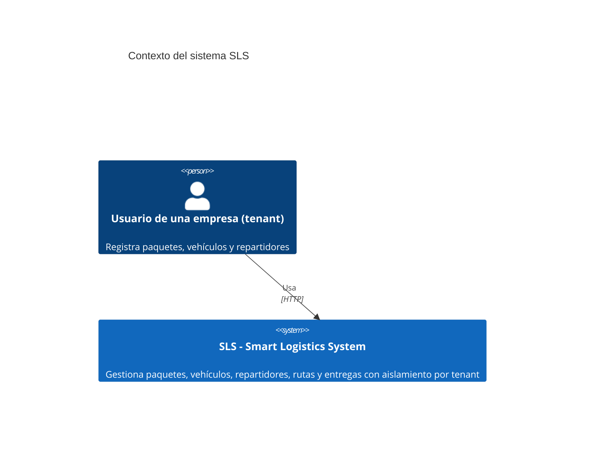
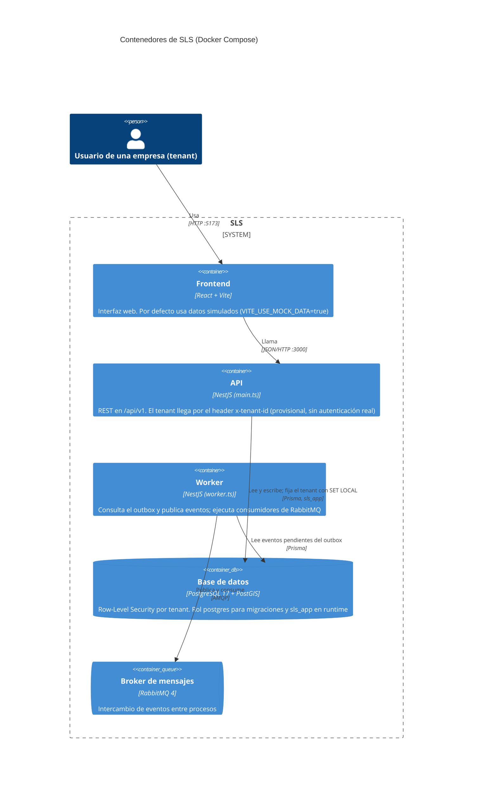
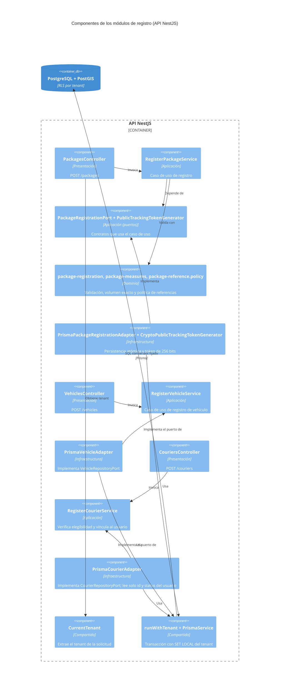

# Diagramas C4 — SLS y módulos de registro (PKG-01 / VEH-01)

Estado: borrador verificado contra el código de `develop` (HEAD `5930e33`) el 2026-10-11.

Alcance y límites de este documento:

- Los niveles 1 y 2 describen lo que existe en `docker-compose.yml` y en `backend/src/` (`main.ts`,
  `worker.ts`). No se dibujan sistemas externos porque no se verificó ninguno.
- El nivel 3 detalla solo los módulos `packages` (registro), `vehicles` y `couriers`. Los demás módulos
  (asignaciones, rutas, entregas, zonas, geocodificación, auditoría) deben ser completados por quienes
  los implementaron; no se dibujan aquí para no afirmar relaciones que no se inspeccionaron.
- Los diagramas usan la sintaxis C4 de Mermaid, que GitHub renderiza.

## Nivel 1 — Contexto

## Nivel 2 — Contenedores

La API no publica en RabbitMQ directamente en los flujos inspeccionados: escribe los eventos en la tabla
de outbox dentro de la misma transacción que el cambio de estado, y el worker los publica.

## Nivel 3 — Componentes de los módulos de registro (dentro de la API)

Regla de dependencias, comprobada automáticamente por `packages-architecture.spec.ts`,
`vehicles-architecture.spec.ts` y `couriers-architecture.spec.ts`: el dominio y la aplicación no
importan NestJS, Prisma ni capas externas. Los adaptadores implementan los puertos definidos en
`application/ports/`.

## Pendiente de completar por el grupo

- Componentes de asignaciones, rutas, entregas, zonas, geocodificación y auditoría.
- Relación entre el frontend y los endpoints de registro, hoy no verificada porque el frontend usa datos simulados.
- Autenticación (AUTH-01): reemplazará el header `x-tenant-id` y cambiará la relación entre frontend y API.
