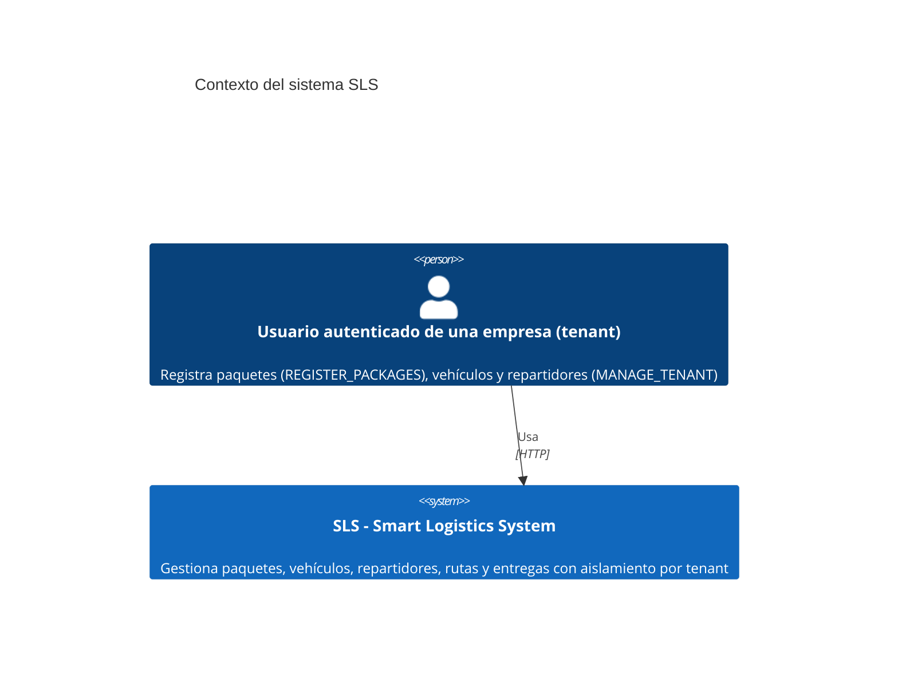
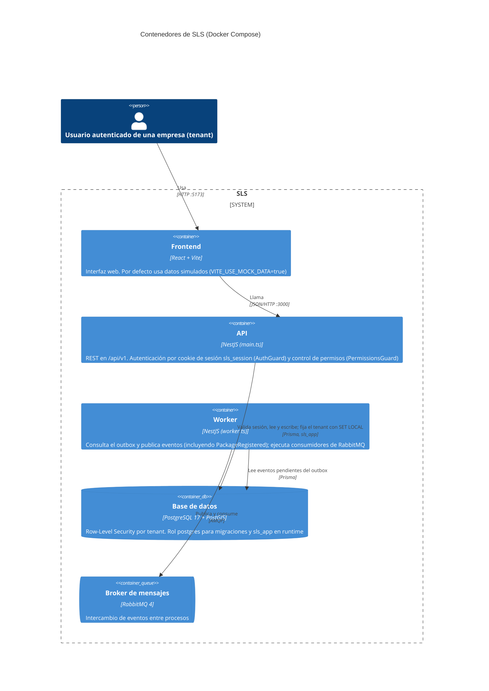
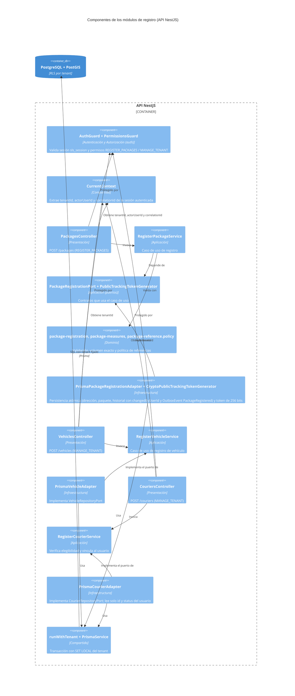

# Diagramas C4 — SLS y módulos de registro (PKG-01 / VEH-01)

Estado: verificado contra la rama `feature/package-vehicle-management` (commits `649f34d..6994cb0` y merge `0e95e61`) el 2026-10-11.

Alcance y límites de este documento:

- `PKG-01` y `VEH-01` están en estado `EN PROGRESO` (`IN_PROGRESS`): únicamente están terminados los
  endpoints de registro (`POST /packages`, `POST /vehicles` y `POST /couriers`).
- Los niveles 1 y 2 describen lo que existe en `docker-compose.yml` y en `backend/src/` (`main.ts`,
  `worker.ts`). No se dibujan sistemas externos porque no se verificó ninguno.
- El nivel 3 detalla los módulos `packages` (registro), `vehicles` y `couriers` junto con su integración
  con `auth` (`AuthGuard`, `PermissionsGuard`). Los demás módulos (asignaciones, rutas, entregas, zonas,
  geocodificación, auditoría) deben ser completados por quienes los implementaron; no se dibujan aquí para
  no afirmar relaciones que no se inspeccionaron.
- Los diagramas usan la sintaxis C4 de Mermaid, que GitHub renderiza.

## Nivel 1 — Contexto

## Nivel 2 — Contenedores

La API no publica en RabbitMQ directamente en los flujos inspeccionados: escribe los eventos (como
`PackageRegistered` al registrar un paquete) en la tabla `OutboxEvent` dentro de la misma transacción que
la escritura de dominio e historial, y el worker los publica.

## Nivel 3 — Componentes de los módulos de registro (dentro de la API)

Regla de dependencias, comprobada automáticamente por `packages-architecture.spec.ts`,
`vehicles-architecture.spec.ts` y `couriers-architecture.spec.ts`: el dominio y la aplicación no
importan NestJS, Prisma ni capas externas. Los adaptadores implementan los puertos definidos en
`application/ports/`.

## Pendiente de completar por el grupo

- Resto de `PKG-01` (consulta, clasificación, historial HTTP y paso 0) y resto de `VEH-01` (listados,
  capacidad, estados y turnos).
- Componentes de asignaciones, rutas, entregas, zonas, geocodificación y auditoría.
- Relación entre el frontend y los endpoints de registro, hoy no verificada porque el frontend usa datos simulados.
