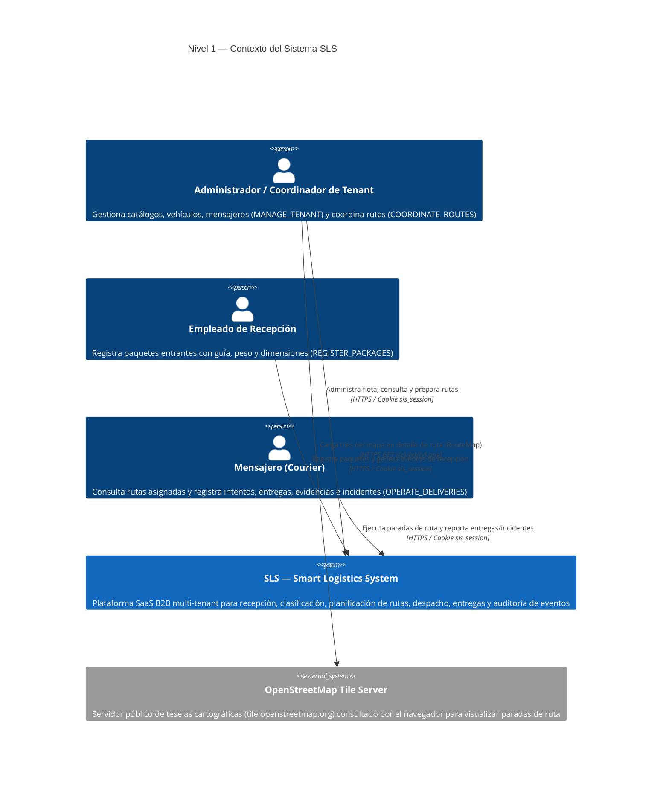
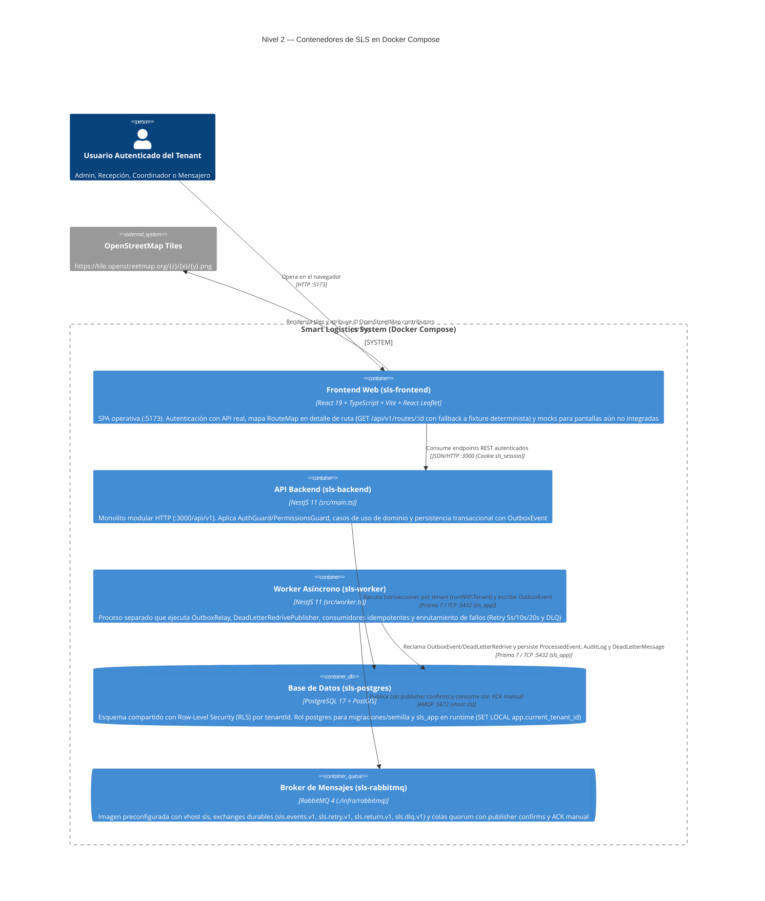
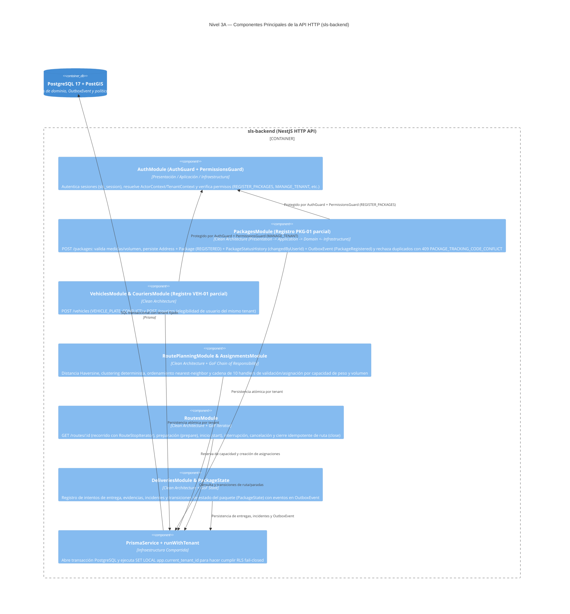
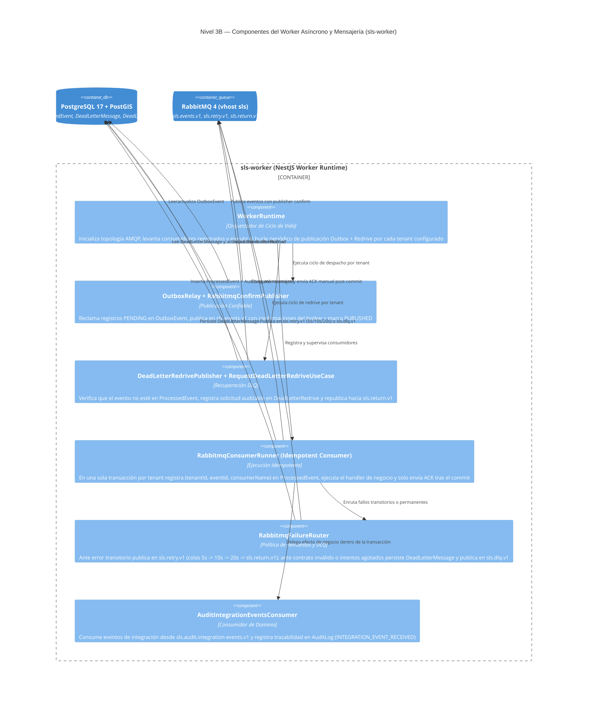

# Diagramas C4 del Sistema — Smart Logistics System (SLS)

Estado: verificado sobre la rama `feature/mvp-demo-flow` el 2026-10-11.

Este documento presenta los tres niveles de diagramas C4 (Contexto, Contenedores y Componentes de API/Worker) del sistema **SLS**, reflejando la arquitectura orientada a eventos, las fronteras de **Clean Architecture**, el aislamiento multi-tenant por **Row-Level Security (RLS)**, los patrones **GoF** (`Chain of Responsibility`, `State`, `Iterator`), los patrones de mensajería (`Transactional Outbox`, `Idempotent Consumer`, `Retry 5s/10s/20s`, `Dead Letter Queue` con redrive auditable) y la visualización geográfica de paradas con **OpenStreetMap (`RouteMap`)**.

---

## Nivel 1 — Diagrama de Contexto (C4 Context)

---

## Nivel 2 — Diagrama de Contenedores (C4 Container)

---

## Nivel 3 — Diagrama de Componentes: API Backend y Worker Asíncrono (C4 Component)

### 3.1 Componentes de la API HTTP (`sls-backend` — `src/main.ts`)

### 3.2 Componentes del Proceso Worker (`sls-worker` — `src/worker.ts`)

---

## Decisiones Arquitectónicas y Límites del Alcance Actual

1. **Clean Architecture verificada por pruebas:**
   - En cada módulo (`packages`, `vehicles`, `couriers`, `zones`, `assignments`, `routes`, `deliveries`), `domain/` y `application/` están aislados de NestJS, Prisma y RabbitMQ (`*-architecture.spec.ts`).
2. **Patrones de Mensajería Confiable (`RMQ-01` + `DEMO-01`):**
   - **Transactional Outbox:** Los casos de uso de escritura (como `RegisterPackageService`) insertan `OutboxEvent` (`PackageRegistered`) en la misma transacción PostgreSQL que las entidades de dominio y el historial (`PackageStatusHistory` con `changedByUserId`).
   - **Idempotent Consumer:** `RabbitmqConsumerRunner` garantiza entrega efectiva única por consumidor mediante la restricción única `(tenantId, eventId, consumerName)` en `ProcessedEvent` dentro de la misma transacción del efecto de negocio, enviando `ACK` únicamente después del `COMMIT`.
   - **Retry con Backoff y Dead Letter Queue:** Los errores transitorios se reintentan hasta 3 veces mediante colas con TTL escalonado (`5s/10s/20s`) que retornan por `sls.return.v1`. Los mensajes con contrato inválido o intentos agotados se almacenan con todo su contexto en `DeadLetterMessage` y cola `sls.dlq.v1`, desde donde pueden reencolarse deliberadamente con auditoría (`DeadLetterRedrive`).
3. **Visualización Geográfica con OpenStreetMap (`RouteMap`):**
   - El componente aislado [`RouteMap`](file:///home/zirox/Documents/GitHub/SLS-Smart-Logistics-System/frontend/src/features/routes/RouteMap.tsx) muestra tiles de `tile.openstreetmap.org`, atribución `© OpenStreetMap contributors`, marcadores numerados por `stopNumber` y una `Polyline` que conecta la secuencia de paradas calculada por el backend.
   - No realiza geocodificación externa (Nominatim), no descarga mapas offline ni representa navegación vial giro a giro o seguimiento GPS en tiempo real. La lista de paradas permanece siempre disponible en la vista de detalle de ruta.
4. **Alcance honesto de `PKG-01` y `VEH-01`:**
   - `PKG-01` y `VEH-01` permanecen en estado `IN_PROGRESS`: están implementados y protegidos con `AuthGuard` + `PermissionsGuard` los endpoints de registro (`POST /packages` con código de duplicado `PACKAGE_TRACKING_CODE_CONFLICT`, `POST /vehicles` y `POST /couriers`). Los listados, edición de capacidad, turnos y clasificación HTTP siguen declarados como trabajo pendiente.
